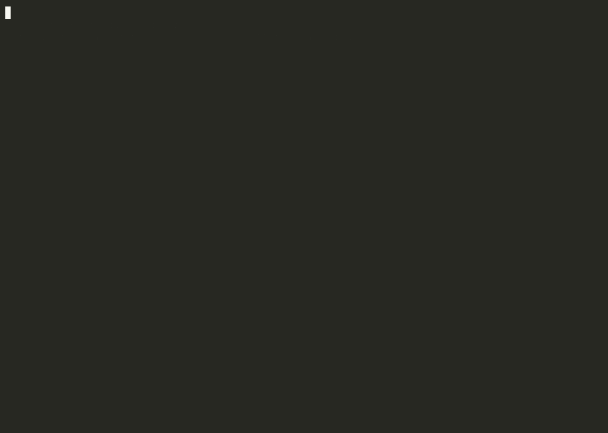

<div align="center">

# Proofgate

**Prove what a policy change does before it ships.**

For engineers reviewing changes to finite access-control policies.

[Live demo](https://gerardrecinto.github.io/proofgate/) · [Design](docs/DESIGN.md) · [Changelog](CHANGELOG.md)

[](https://github.com/gerardrecinto/proofgate/actions/workflows/ci.yml)
[](https://github.com/gerardrecinto/proofgate/actions/workflows/codeql.yml)
[](https://github.com/gerardrecinto/proofgate/releases)
[](LICENSE)



</div>

A tidy-up PR regroups an access policy's rules and folds a couple together. Reviewers read the file diff and see nothing wrong. It quietly lets an SRE delete production and a contractor deploy to staging. The diff of the file is not the diff of the decisions.

Proofgate computes the second one, exactly, and makes it a condition of shipping:

```
$ proofgate diff policy.json policy_v2.json
7 newly allowed, 0 newly denied

  NEWLY ALLOWED  1 request   action=delete  approved=yes  env=prod  role=sre
                 was freeze_prod_delete, now sre_prod
  NEWLY ALLOWED  6 requests  action=deploy|rollback|delete  env=staging  role=contractor
                 was default deny, now contractor_env
```

Every declared invariant still passes in that example. The diff is what shows the change.

## Three languages, each doing its job

| | Language | Role |
|---|---|---|
| `dsl/` | Ruby | Write policies as rules and invariants that read like the sentence they mean. |
| `core/` | Rust | The prover: exact semantic diff and invariant proofs over the whole request space. Also compiled to WebAssembly. |
| `gateway/` | Go | Serves decisions, and refuses to activate a bundle that breaks an invariant or widens access without an approval for that exact change. |

```ruby
dimension :env,    %w[dev staging prod]
dimension :role,   %w[engineer sre contractor]
dimension :action, %w[read deploy rollback delete]

never  :no_contractor_prod, "Contractors never change prod",
       env: "prod", role: "contractor", action: %w[deploy rollback delete]
always :sre_can_roll_back,  "SREs can always roll back", role: "sre", action: "rollback"

deny  :freeze_prod_delete, "Nobody deletes in prod", env: "prod", action: "delete"
allow :sre_prod,           "SREs run prod with approval", env: "prod", role: "sre", approved: "yes"
```

An invariant is proven over every possible request, not sampled:

```
$ proofgate check policy.json
  PROVEN   never allow: Contractors never change prod
  PROVEN   always allow: SREs can always roll back
```

## Quick start

```
git clone https://github.com/gerardrecinto/proofgate && cd proofgate
make build
export PATH="$PWD/dsl/bin:$PWD/core/target/release:$PWD/bin:$PATH"

proofgate-rb compile examples/deploys/policy_v2.rb -o /tmp/v2.json
proofgate diff examples/deploys/policy.json /tmp/v2.json
make demo        # the whole flow, including the gateway
```

Needs Rust, Go 1.22+ and Ruby 2.6+. The playground at the top of the [live demo](https://gerardrecinto.github.io/proofgate/) needs nothing: the prover runs in your browser.

## The gateway

```
(umask 077; openssl rand -hex 32 > approval.key)
proofgate-gateway serve -addr 127.0.0.1:8080 -prover core/target/release/proofgate -bundle examples/deploys/policy.json \
  -audit audit.jsonl -approval-key-file approval.key
```

| Endpoint | |
|---|---|
| `POST /v1/decide` | `{"request": {"env": "prod", ...}}` returns the effect, the rule that decided it, and the bundle digest |
| `PUT /v1/bundle` | propose a new policy. Refused with the evidence if an invariant fails, or if it widens access with no valid `X-Proofgate-Approval` |
| `GET /v1/bundle`, `GET /healthz` | what is active, and liveness |

An approval is `proofgate-gateway approve -key-file approval.key old.json new.json`. It signs the old digest, the new digest and the fingerprint of the changed requests, so it authorises that change and no other. Activations and invariant or approval refusals go to a hash-chained log you can check with `proofgate-gateway verify-audit`.

The key-generation command needs OpenSSL. Keep the key out of version control. The bundle endpoint has no built-in caller authentication. Keep it on a trusted local interface or put it behind your authentication and network controls. See the [security policy](.github/SECURITY.md).

## How it is tested

- The Rust prover is checked against a brute-force evaluator on randomized policies. Counts, diffs, invariants and redundancy are each compared with evaluating every request one at a time.
- The Go evaluator is replayed over every request of the example policies against the Rust one, and must agree on all of them.
- The gateway's gate has a test for each way to get through it: no approval, an approval for a different change, the wrong key, no key configured.
- CI also builds the WebAssembly prover and checks it against the CLI, and fails if the compiled examples are stale.

## Limits

Dimensions are finite and enumerated, and the model is first-match with default deny. There are no ranges or regexes, so bucket them into values. A green result means the policy you wrote does what the invariants say over the dimensions you declared, nothing more. See [docs/DESIGN.md](docs/DESIGN.md) for the algorithm, the limits and the prior art.

MIT licensed. [Optional paid help](SUPPORT.md) is available for policy modeling and integration review.
